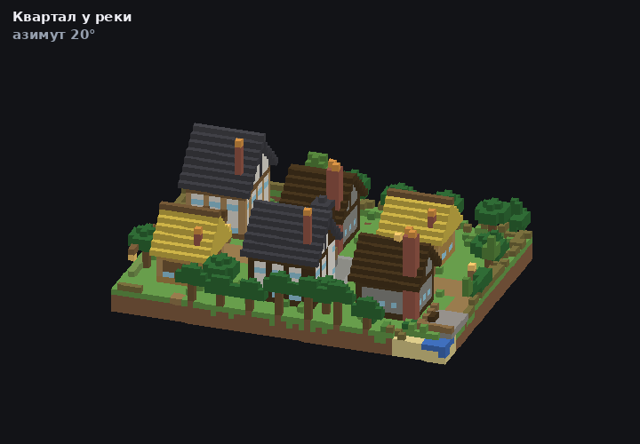

<picture>
  <source media="(prefers-color-scheme: dark)" srcset="assets/banner-dark.png">
  
</picture>

<p align="center"><sub><b>Fedor Molodtsov</b> — AI automation engineer · <a href="https://github.com/itsfedor">github.com/itsfedor</a></sub></p>

# MC Render

[](#quick-start)
[](#why-not-chunky)
[](LICENSE)

Turn `.mca` region files into pictures of the build: still frames from any angle,
an orbit clip, or a build that grows in the order a script placed it.



*Every frame above is rendered from a region file on a headless server — no Minecraft client,
no path tracer, no gameplay.*

## Why not Chunky

Chunky gives you real textures and light, and it is the right tool when its texture assets
match the world's Minecraft version. On a 26.1.x world they do not: blocks the asset pack has
never seen (`bush`, `firefly_bush`, `leaf_litter`, …) render as purple `?` placeholders sprinkled
over the build, and no amount of samples fixes it.

MC Render reads block **names** from the region file and maps them to a palette, so it always
shows the real blocks. Colours are flat and stairs are approximated — it is a clear diagram of
the build, not a photoreal render.

## Quick start

```bash
pip install -r requirements.txt          # numpy, nbtlib, pillow

# still frames, two isometric angles + a close-up, chat-ready WebP
python3 quarter_shots.py \
  --world /path/to/world --box "-60 -4 -779 -739" --y 60 82 --scale 14 \
  --out ./shots --label "Quarter" --angles 0,1

# orbit clip
python3 clips.py orbit --world /path/to/world --box "-60 -4 -779 -739" \
  --y 60 82 --scale 7 --frames-count 20 --out orbit.gif

# one frame, any angle you like
python3 voxel_render.py /path/to/world/region/r.-1.-2.mca -60 -4 -779 -739 60 82 14 out.png 0 "Quarter"
```

`--world` is a world folder with `level.dat` and `region/`; the tool picks the region file
covering the centre of `--box`. `--box` is `x0 x1 z0 z1`, inclusive.

## Build-growth clips

`clips.py growth` replays a `.bk` script — the batch format from
[BuildKit](https://github.com/itsfedor/buildkit-mc) — into a block map and renders a frame
every N commands, then adds structures in the order given. That is how the BuildKit demo GIF
is made: layout script first, houses after.

```bash
python3 clips.py growth --world /path/to/world --box "-60 -4 -779 -739" --y 60 82 \
  --script city.bk --houses "elder:-56:-46:-774:-762,butcher:-22:-13:-770:-762" \
  --out growth.gif
```

## Files

| File | Role |
|---|---|
| `voxel_render.py` | single-frame isometric renderer with shapes for stairs, slabs, fences, doors, beds; palette in `COLORS` |
| `quarter_shots.py` | renders several angles, checks the palette, shrinks for chat, prints `IMG`/`SRC`/`UNKNOWN` lines |
| `clips.py` | `orbit` and `growth` GIF clips |
| `lib/region.py` | minimal anvil reader (block states, palettes, heightmaps) |

Unknown blocks are reported once (`unknown-blocks N: ...`) instead of silently rendered in a
wrong colour, and fall back to a keyword guess — wood, quartz, foliage, wool, stone.

## Limitations

- Stairs and slabs are drawn as simplified cuboids; fences, walls, panes, doors and beds have
  real shapes only in `voxel_render.py`.
- One region file per render: a build crossing a region border needs a stitched world folder.
- Palette is hand-mapped. Run it once and check the `unknown-blocks` line before publishing a
  picture.

## License

MIT.
